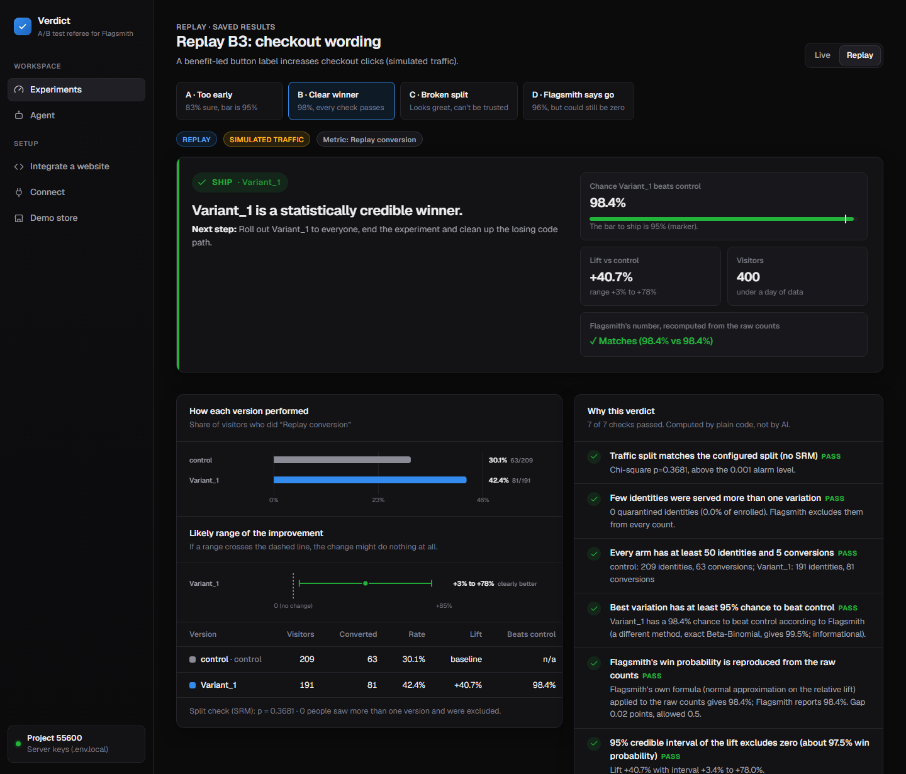
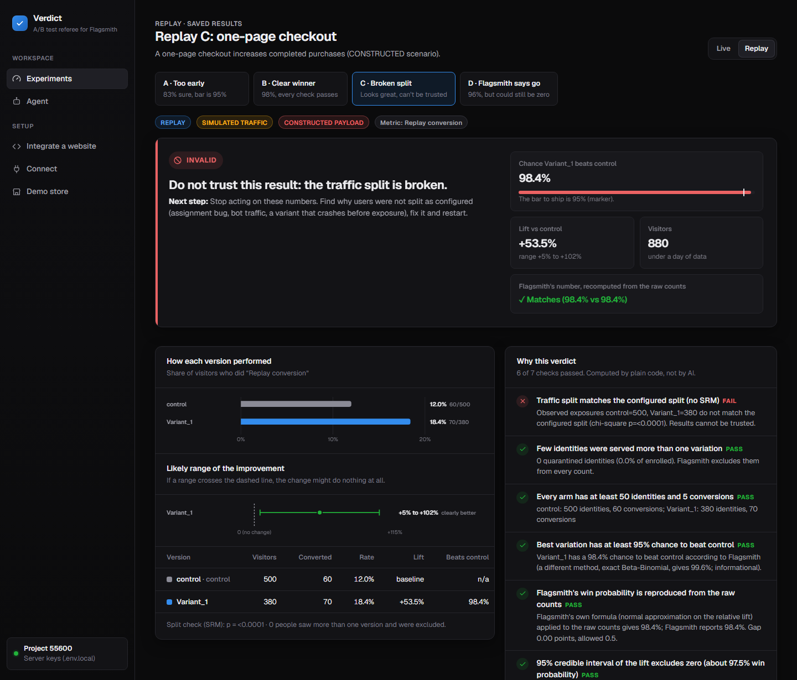
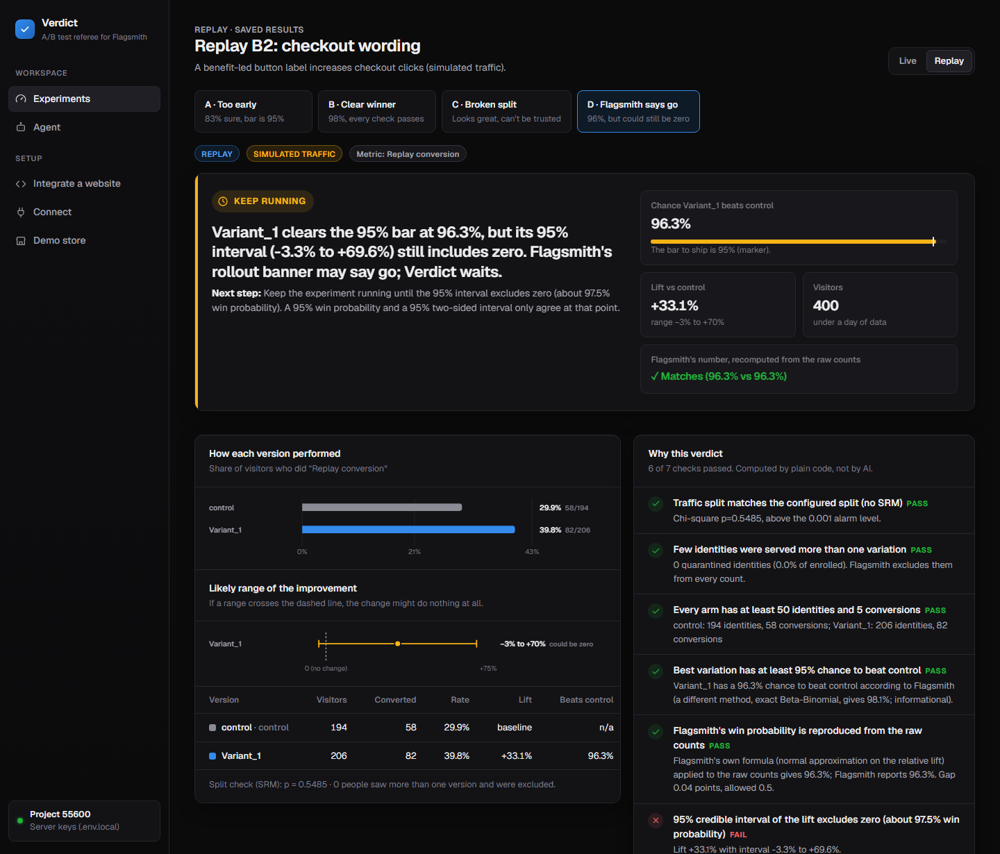
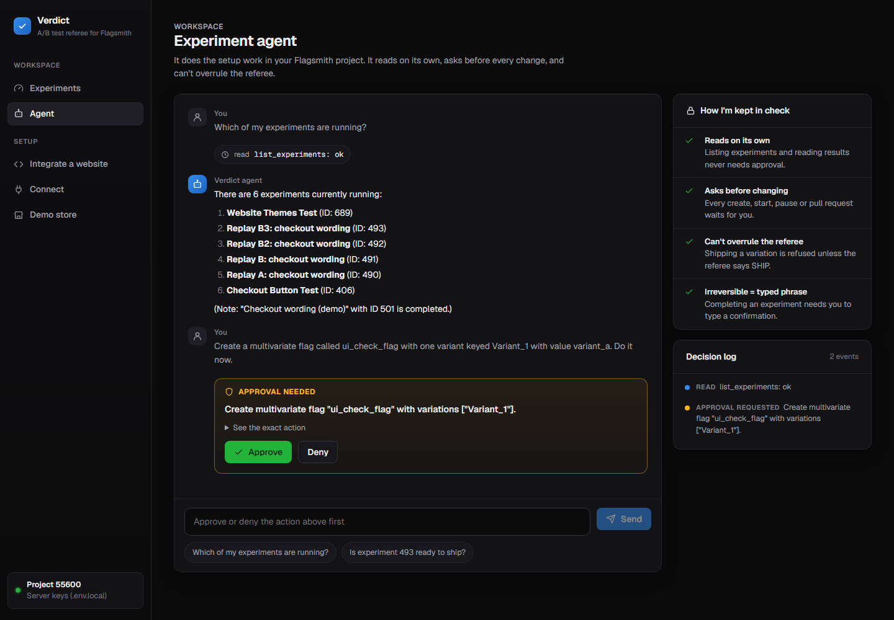
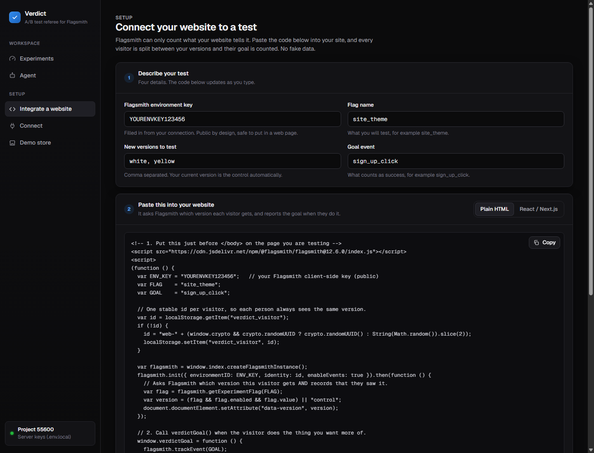

# Verdict

An AI agent that runs A/B tests in Flagsmith, and a referee that decides whether the result can be trusted.

Built solo for [Toggle Wars](https://www.wemakedevs.org/hackathons/flagsmith), Track 02 (AI Agents and Feature Flags).

- **Live app:** [verdict-ai-topaz.vercel.app](https://verdict-ai-topaz.vercel.app/)
- **Demo video:** [Watch on YouTube](https://youtu.be/S1iflJGiO0k)

## What it looks like











## The problem

Say you can't decide whether a button should say "Checkout" or "Buy now". Flagsmith can show half your visitors one wording and half the other, and count who clicks. That part works well.

What it can't tell you is when you're allowed to believe the numbers. People look at a test too early. A test that checks its result ten times and stops at the first good-looking number turns a 1% false-alarm rate into roughly 5% ([Evan Miller](https://www.evanmiller.org/how-not-to-run-an-ab-test.html)). Sometimes the visitors were never split evenly in the first place, so the result means nothing. And once a winner ships, the code for the losing version usually stays in the repo forever.

## What Verdict does

You tell the agent what you want to test. It sets the experiment up in Flagsmith, and a referee reads the results and gives one of four answers:

| Verdict | What it means |
|---|---|
| **SHIP** | The winner is real. Every check passed. |
| **KEEP RUNNING** | Too early to tell, or the evidence is not strong enough yet. |
| **INCONCLUSIVE** | There is a signal, but something blocks shipping (a guardrail got worse, or the numbers don't add up). |
| **INVALID** | The test itself is broken. Don't trust these numbers. |

Every answer comes with a checklist showing what passed, what failed, and what is still uncertain. The decision is ordinary code. The language model never decides anything and can't override the referee. It talks to you and proposes actions.

After a winner ships, the agent opens a GitHub pull request that deletes the losing code. [Pull request #1](https://github.com/sharmaShivam23/Verdict-Ai-/pull/1) in this repo was made that way, by a real run, and it passed the repo's CI.

## How a full run goes

1. You ask the agent to set up a test. It proposes a flag, a metric and a hypothesis. **You approve each step.**
2. Visitors use the page. The page asks Flagsmith which version to show (that counts as one exposure) and reports the click (that counts as one conversion).
3. Flagsmith adds it all up. Verdict reads the results through the Admin API.
4. The referee runs its checks and gives a verdict.
5. If it says SHIP, you approve completing the experiment by typing `COMPLETE <id>`. The server checks the verdict again by itself and refuses if it isn't SHIP.
6. The agent opens a pull request that removes the losing code. The body names the experiment and the winning version, and adds the referee's verdict and checklist when Flagsmith's results can still be read at that point. (For [pull request #1](https://github.com/sharmaShivam23/Verdict-Ai-/pull/1) they could not, so its description says so instead.)
7. You review and merge.

## What the agent can and can't do

| Action | Rule |
|---|---|
| Read experiments, fetch results, search your code, write the snippet for your site, check events are arriving | Runs on its own (none of these change anything) |
| Create a flag, metric or experiment; start or pause; open a pull request | Stops and waits for your approval |
| Complete an experiment (can't be undone) | Needs a typed confirmation, **and** is refused unless the referee says SHIP for exactly that variation |
| Edit files | Only inside the folder you chose, and only one code pattern (below). While you set up a test it never edits your files: it gives you the code to paste. |
| Which version to keep after cleanup | Read from Flagsmith's own record of the rollout decision, not from the model |

These rules are code in [`lib/agent/policy.ts`](lib/agent/policy.ts) and [`lib/agent/tools.ts`](lib/agent/tools.ts), not instructions in a prompt, and they are covered by tests. The agent's API refuses anyone who isn't signed in, and refuses cross-site requests.

## What the referee checks

1. **Traffic split.** Did people land in each version in the proportions configured? I run my own chi-square test, because Flagsmith's own field for this (`srm_p_value`) stayed empty in every run I did.
2. **Quarantined identities.** People who saw more than one version are excluded by Flagsmith. Too many is a warning.
3. **Enough data.** At least 50 people and 5 conversions in every arm, the same threshold Flagsmith uses.
4. **Win probability at 95% or higher.**
5. **The number can be reproduced.** The referee recomputes Flagsmith's win probability from the raw counts with Flagsmith's own formula. If the two disagree, it refuses to ship.
6. **The 95% interval excludes zero.**
7. **Guardrail metrics** didn't get worse.

### Two things I found about Flagsmith's numbers

**Its "chance to win" is a normal approximation on the relative lift**, not the usual Bayesian calculation. Its interval is symmetric around the lift, which gave it away. Using `Φ(lift / se)` with a delta-method standard error, I reproduce Flagsmith's figure to within 0.001 on every real result I captured ([`lib/stats.ts`](lib/stats.ts), tests in [`lib/stats.test.ts`](lib/stats.test.ts)). That is what makes check 5 possible.

**Flagsmith's two signals can disagree.** Its rollout banner suggests going ahead at a 95% chance to win. But its 95% interval only clears zero at about 97.5%. In between, Flagsmith's docs describe the same result as both ready to roll out and inconclusive. Verdict waits and says exactly why. Replay scenario D shows a real one: 96.3% win probability, interval from -3.3% to +69.6%.

## Use it on your own site

Nothing here is tied to my account. Each person works on their own Flagsmith project.

**Signing in.** The replay scenarios on the dashboard need no account. For everything that touches a real project (Live results, the agent, Connect, Integrate) you either sign in with GitHub or press **Continue without login**.

- **Sign in with GitHub** creates your account the first time. There is no sign-up form and no password: Verdict only reads your public GitHub profile (scope `read:user`).
- **Continue without login** gives you the whole app as a guest. You still use your own keys. A guest and their saved projects are kept for 7 days and then deleted automatically.
- Nobody, guest or not, can use the keys in the server's `.env.local` to reach a Flagsmith project or a repo. Your projects are stored encrypted (AES-256-GCM) in MongoDB, tied to your account, and only a masked summary is ever sent to the browser.

**Then, in the sidebar:**

1. **Connect:** add a project. You paste your Flagsmith API key, environment key and project id, and optionally your GitHub repo, the folder the agent may edit, a GitHub token and a Gemini key. **Test connection** really calls Flagsmith and GitHub and tells you what failed. You can keep several projects, edit or delete them (leave a key blank to keep the saved one), and choose which one is active.
2. **Agent:** say "I want to integrate my website". It asks one question at a time (plain HTML or React, which element and what it says today, the new wording, what counts as success), then sets the flag, metric and experiment up with your approval at each step, and hands you the code to paste and the environment variable line. After you deploy, it checks that events are arriving, and only then offers to start the experiment. If you don't give it a Gemini key, it uses the server's.
3. **Integrate a website:** the same code generator as a form, without the chat. Plain HTML (one script tag, no build step) or React. **Start watching** follows Flagsmith's event counter, which only goes up when a real browser reports a visit or a click, so you get proof your site is connected.
4. After a winner ships, the cleanup pull request is opened in **your** repository, and it can only edit files in the folder you chose.

`public/shop-example.html` is a one-file shop that uses exactly that snippet, to show it working on a normal page.

If you deploy this, set `VERDICT_SECRET` to a long random string and point `MONGODB_URI` at a database. Without `VERDICT_SECRET` the server makes a new random secret each time it starts, which logs everyone out and makes saved projects unreadable. The agent keeps its conversations in memory, so run it on one long-lived server, not on serverless functions.

## How Flagsmith is used

Experiments, metrics and results are the product here, not a side feature.

| What | Flagsmith call |
|---|---|
| Create a multivariate flag | `POST projects/{id}/features/`, then `PUT .../mv-options/{id}/` to set each variation key |
| Create a metric | `POST environments/{key}/experiment-metrics/` |
| Create, start, pause an experiment | `POST .../experiments/`, `.../start/`, `.../pause/` |
| Complete it and set what the flag serves | `POST .../experiments/{id}/complete/` |
| Read results | `POST .../results/refresh/`, then `GET .../results/` and `.../experiments/{id}/` |
| Show the right version, count the click | JavaScript SDK: `useExperiment`, `trackEvent`, `flushEvents` |

## Try it

You need Node 22.12 or newer (I used 24). The app itself runs on Node 20.9, but the test runner needs 22.12.

```bash
git clone https://github.com/sharmaShivam23/Verdict-Ai-.git
cd Verdict-Ai-
npm ci
npm run dev
```

Open <http://localhost:3000>. **This works with no keys at all.** The dashboard starts in Replay mode, with four saved scenarios:

- **A.** 83% win probability. KEEP RUNNING.
- **B.** 98% and every check passes. SHIP.
- **C.** Looks like a big win, but visitors were split 500 to 380 instead of evenly. INVALID.
- **D.** 96%, which clears Flagsmith's banner, but the interval still includes zero. KEEP RUNNING.

To use more, copy `.env.example` to `.env.local` and add keys:

| You want | You need |
|---|---|
| Replay dashboard | nothing |
| Guest mode, saved projects, Live results, the agent | `MONGODB_URI` (a free MongoDB Atlas cluster works; allow your IP in Network Access) and `VERDICT_SECRET`, then your own Flagsmith keys on the Connect page |
| "Sign in with GitHub" | a GitHub OAuth App: `GITHUB_OAUTH_CLIENT_ID`, `GITHUB_OAUTH_CLIENT_SECRET`, callback URL `http://localhost:3000/api/auth/github/callback` |
| The agent's language model | a free [Gemini key](https://aistudio.google.com), either in `.env.local` as `GEMINI_API_KEY` (shared by everyone who has no key of their own; set `VERDICT_DISABLE_SHARED_MODEL=1` to stop that) or on each person's Connect page |
| The demo page (`/demo`) | the Flagsmith environment key as `NEXT_PUBLIC_FLAGSMITH_ENVIRONMENT_KEY` |
| Cleanup pull requests | a GitHub token and repo, on the Connect page (without them the agent shows the diff) |

The scripts in `scripts/` (traffic simulator, capture helpers) still read their Flagsmith keys from `.env.local`; the web app never does.

Your Flagsmith account needs Experimentation, which is in beta. It was available on mine.

Pages: `/` experiments and verdicts, `/agent` the agent, `/integrate` code for your own website, `/connect` your projects, `/login` sign in, `/demo` a small store.

```bash
npm test          # unit tests
npm run typecheck
npm run lint
npm run build
```

## What is real and what is not

I'd rather say this plainly than have you find it.

- **The traffic in my demos is simulated.** Nobody else used this, so a script sends fake visitors (all named `sim-...`). The screens say SIMULATED TRAFFIC. The pull request body carries the same disclosure when it can load the results, but PR #1 could not, so its description does not mention it. The numbers are real Flagsmith output for those visitors, but they say nothing about real users.
- **The website integration is real, and I tested it.** I ran the generated snippet the way a browser loads it against my Flagsmith project: the visitor was given a version, and Flagsmith's event counter rose by exactly two (one visit, one click). A one-file example shop (`public/shop-example.html`) also ran in a real browser and reported its visit. I have not yet had a stranger's real website use it.
- **Accounts and saved projects: partly tested.** The rules (each person sees only their own projects, a blank key on edit keeps the saved one, encryption, session expiry, the OAuth `state` check) are covered by unit tests. Guest mode I ran end to end against a real MongoDB Atlas database: it created a guest, set the cookie, let the guest reach the agent and Connect pages, refused signed-out and forged-cookie requests, and used the server's Gemini key for the agent. **I have not yet completed a real "Sign in with GitHub" round trip**, and none of this has had a security review.
- **The agent-guided integration chat is built and its tools are tested** (the snippet it writes is checked against the cleanup tool, and the event check against fake Flagsmith responses). I have not yet watched the full conversation run end to end with a live model.
- **Replay scenarios A, B and D are real Flagsmith responses**, captured from live experiments and run through the same code as live data. **Scenario C is hand-built**, in Flagsmith's exact response shape. I couldn't get a real broken split to show up in the results, so it carries a red "CONSTRUCTED PAYLOAD" badge.
- **The cleanup only understands one pattern**: `pick(useExperiment("flag"), { control: "A", variant_a: "B" })`. It refuses anything else with a reason instead of guessing. It is a reference implementation, not a general refactoring tool, and a human still reviews the pull request. It also doesn't touch comments, so an old comment can be left behind.
- **The independent check covers two-version tests on a yes/no metric.** For anything else the dashboard says "Not audited" and why.
- **Flagsmith Experimentation is in beta.** Results lag by a minute or so and refresh at most every five minutes.
- Agent conversations live in memory and disappear on restart. That's fine for a demo and wrong for production.
- I built this alone during the hackathon, with an AI coding assistant. Apart from the two items above that say otherwise, what is described here is either covered by a test or was checked against live Flagsmith.

## Things I learned about Flagsmith Experimentation

If you're building on it, these cost me time:

- Creating a flag with variations drops each variation's `key`. A variation with no key records **no exposures**, with no error. Set the keys afterwards.
- `PATCH` on a variation returns HTTP 500. A full `PUT` works.
- An experiment must include **every** variation of the flag, or creation fails with "Must include all feature's variants".
- The default win-probability bar (95%) and the interval check disagree between 95% and 97.5%, as above.
- Rotating an Organisation API key invalidates the old one immediately, with a 401.

## Project layout

```
app/
  page.tsx            dashboard (live and replay)
  agent/              the chat page with approval cards
  login/              sign in with GitHub, or continue as a guest
  connect/            your saved projects: add, edit, delete, choose the active one
  integrate/          code for your own website
  demo/               the store page under test
  api/agent/          the agent's two endpoints (sign-in required)
  api/auth/           GitHub sign-in, guest start, sign out
lib/
  referee.ts          the verdict and the checklist
  stats.ts            the math, including Flagsmith's formula
  replay.ts           the four replay scenarios
  connections-store.ts  users and their encrypted projects (MongoDB)
  auth/               sign-in with GitHub and the session cookie
  snippets.ts         the code written for your website
  flagsmith/          API client, response adapter, captured real responses
  agent/              loop, policy, tools, cleanup codemod, model adapters (Gemini, Claude)
  github/             opens the pull request
scripts/              traffic simulator, capture and setup helpers
```

## License

MIT. See [LICENSE](LICENSE).
